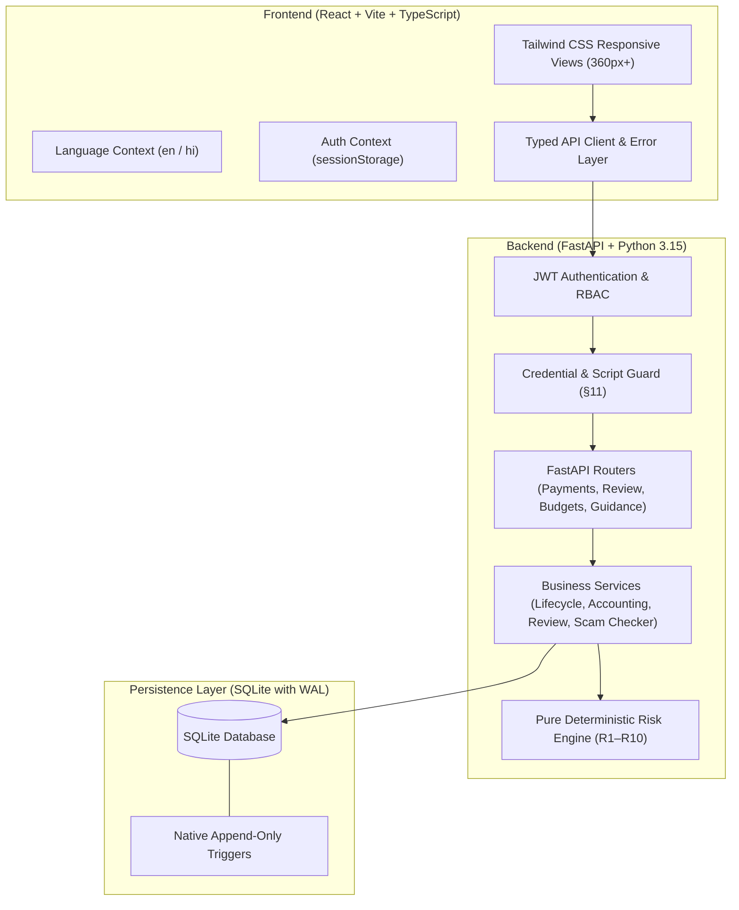
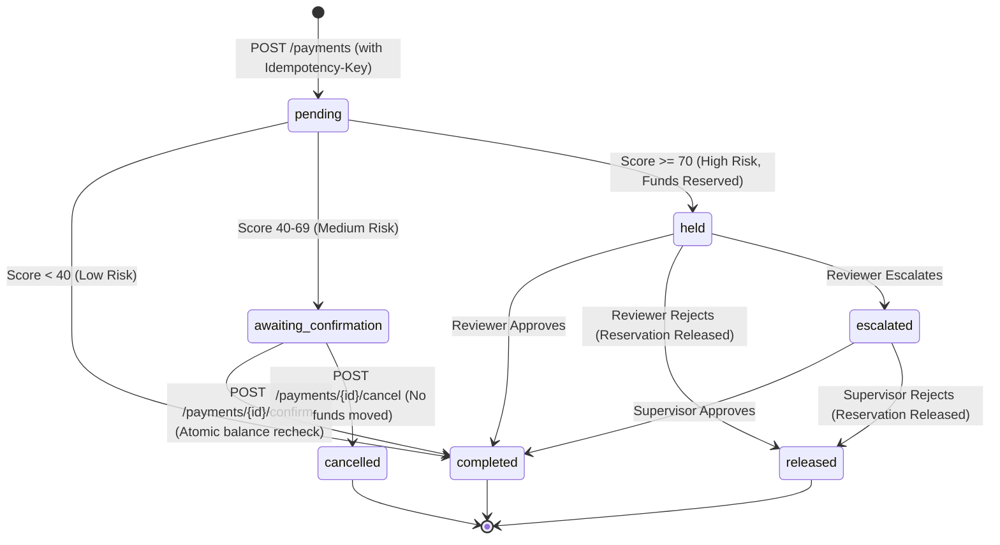

# PayGuard 360 — System Architecture (docs/ARCHITECTURE.md)

## 1. System Overview

PayGuard 360 is structured as a decoupled, full-stack financial safety platform for India:

---

## 2. Deterministic Explainable Risk Engine (§10)

`backend/app/services/risk_engine.py` is implemented as an immutable, side-effect-free pure function:
$$\text{evaluate\_risk}(\text{scoring\_context}, \text{payment}, \text{rules\_config}, \text{now}) \to \text{RiskAssessmentResult}$$

### Architectural Guarantees:
1. **Zero I/O:** The engine performs no database queries or network calls. All context is fetched in one consistent database snapshot before invocation.
2. **Deterministic Reproducibility:** Fixed inputs produce identical scores and rule codes regardless of execution order.
3. **Pure Integer Math:** Sums points across fired rules R1–R10 and caps score at 100:
   $$\text{score} = \min\left(100, \sum_{i=1}^{10} \text{points}(R_i)\right)$$
4. **Canonical Risk Bands:**
   - **Low Risk:** 0–39 points (Immediate completion)
   - **Medium Risk:** 40–69 points (Explicit user confirmation required)
   - **High Risk:** 70–100 points (Payment held, funds reserved for human review)
5. **Configurable Rules:** Weights, boundaries, scam phrases, and version (`1.0.0`) are loaded from `risk_rules.json`, validated against JSON schema at startup.

---

## 3. Financial Ledger & Balance Integrity (§8)

All currency is strictly stored and calculated in **integer paise** ($1\text{ INR} = 100\text{ paise}$). Floats are strictly prohibited via Pydantic validators.

### Balance Continuity Equations:
1. **Completed Balance:**
   $$\text{completed\_balance} = \text{opening\_balance} + \text{completed\_incomes} - \text{completed\_expenses}$$
2. **Held (Reserved) Balance:**
   $$\text{held\_balance} = \sum \text{amount}(\text{transactions where status } \in \{\text{'held'}, \text{'escalated'}\})$$
3. **Available Balance:**
   $$\text{available\_balance} = \text{completed\_balance} - \text{held\_balance}$$

### Live 4/4 Reconciliation Checks (`GET /accounting/reconciliation`):
1. `category_totals_match`: Sum of category spending equals total completed expenses.
2. `net_cash_flow_integrity`: Net cash flow matches income minus expenses.
3. `ledger_balance_continuity`: Completed balance matches opening balance plus net cash flow.
4. `available_funds_reservation`: Available balance exactly matches completed balance minus held balance.

---

## 4. Payment Lifecycle State Machine (§9)

### Concurrency & Two-Person Safeguards:
- **Optimistic Locking:** Reviewer decisions require `expected_version` matched in database updates.
- **Separation of Duties:**
  - Reviewers cannot review transactions where `user_id == current_user.id`.
  - Supervisors cannot resolve cases they escalated (`resolver_id != escalator_id`).

---

## 5. Bilingual Localization Framework (§15)

- Dictionaries `en.json` and `hi.json` in `frontend/src/i18n/`.
- 100% key and placeholder parity enforced by automated Vitest tests.
- React context `LanguageContext.tsx` provides `t(key, params)` with automatic integer paise formatting.
- User preference persisted in `localStorage` under `payguard_lang`, strictly isolated from session tokens.
